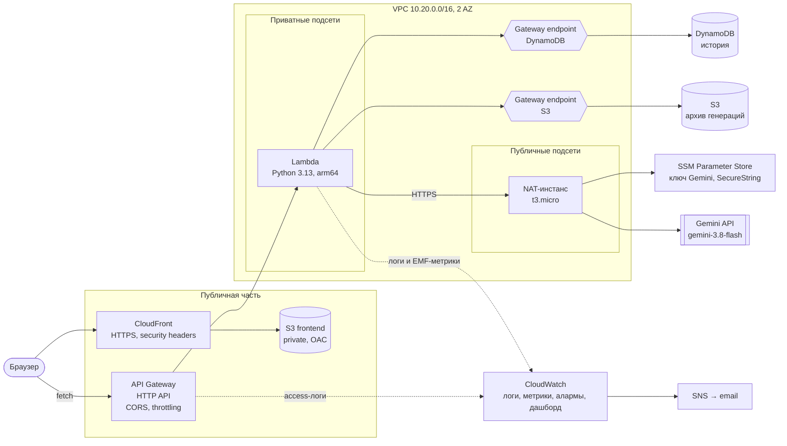

# Инфраструктура

Черновик разделов документации по инфраструктуре: архитектура, потоки данных, безопасность, стоимость, мониторинг, troubleshooting. Можно переносить в итоговый документ.

## Архитектура



Связанные сервисы (требование: минимум 4): CloudFront, S3, API Gateway, Lambda, DynamoDB, SSM Parameter Store, VPC, EC2 (NAT), IAM, CloudWatch, SNS.

### Решения и почему так

| Решение | Почему |
|---|---|
| HTTP API, а не REST API | дешевле, проще, CORS из коробки; лимит интеграции 30 с нам подходит |
| Lambda в приватных подсетях | у функции нет публичного адреса, входящий трафик в VPC невозможен |
| NAT‑инстанс вместо NAT Gateway | NAT Gateway ≈ $32/мес — весь бюджет за неделю; t3.micro входит в free tier |
| Gateway endpoints для DynamoDB и S3 | бесплатные; трафик к базе и архиву не идёт через NAT и интернет |
| Ключ Gemini в SSM, не в переменных Lambda | ключ не виден в консоли Lambda и не попадает в Terraform state |
| CloudFront + OAC | HTTPS и CDN; бакет сайта закрыт, читать его может только этот дистрибутив |
| DynamoDB PROVISIONED 5/5 | укладывается в бесплатные 25 RCU/WCU навсегда, а не только 12 месяцев |
| GSI `byCreatedAt` | история «новые сверху» одним Query без сканирования таблицы |
| Remote state в S3 + блокировка в DynamoDB | вся команда работает с одним state; два `apply` одновременно не испортят его |

## Потоки данных

### Генерация сценариев

1. Браузер загружает `index.html` и `config.js` с CloudFront. В `config.js` Terraform записал адрес API.
2. Пользователь заполняет бриф → `POST /generate` (JSON) в API Gateway.
3. API Gateway проверяет CORS и лимит запросов (5/с, всплеск 10) и вызывает Lambda.
4. Lambda валидирует бриф: обязательный клиент, длины полей, 1–4 сценария.
5. При холодном старте Lambda читает ключ из SSM через NAT и кэширует его в памяти.
6. Lambda собирает промпт (системный промпт + бриф в тегах `<brief>`) и вызывает Gemini через NAT. Ответ запрашивается в строгой JSON‑схеме `{variants: [{title, script}]}`.
7. Сценарии сохраняются в DynamoDB (через gateway endpoint), полный бриф с ответом модели — в S3 `generations/<дата>/<requestId>.json`.
8. Lambda пишет в лог метрики (время ответа Gemini, число сценариев, ошибки) и возвращает `{requestId, variants}`.

### История и правки

1. `GET /history?limit=20` → Query по индексу `byCreatedAt` (новые сверху).
2. `PUT /history/{requestId}` с исправленными сценариями → UpdateItem с условием «запись существует», флаг `edited = true`.

## Безопасность

| Слой | Мера |
|---|---|
| Сеть | Lambda в приватных подсетях; SG Lambda без входящих правил, исходящий только 443; SG NAT пускает 443 только из приватных подсетей; на NAT нет SSH и ключей, доступ только через Session Manager |
| Доступ к API | CORS только для адреса сайта (и localhost для разработки); троттлинг 5 rps / 10 burst защищает квоту Gemini и бюджет |
| Секреты | ключ Gemini — SecureString в SSM (KMS); не в коде, не в Git, не в state, не в переменных Lambda |
| IAM Lambda | минимальные права: 4 действия на одну таблицу, Put/Get только в `generations/*` одного бакета, `GetParameter` на один параметр, `kms:Decrypt` только через SSM |
| IAM команды | ролевые группы; явный Deny на секреты, state, удаление ресурсов, EC2 и бюджет; ключи доступа каждый создаёт себе сам |
| Данные | DynamoDB и все бакеты зашифрованы; бакеты закрыты Block Public Access; политика бакетов запрещает не‑HTTPS запросы; архив удаляется через 30 дней |
| Веб | CloudFront отдаёт только HTTPS и заголовки безопасности (HSTS, X‑Frame‑Options, nosniff); IMDSv2 на NAT |
| Промпт‑инъекции | текст брифа передаётся модели как данные в теге `<brief>`, попытки закрыть тег нейтрализуются; ответ принимается только в JSON‑схеме |
| Логи | в логи не пишется текст брифов и сценариев, только идентификаторы, длительности и статусы |
| State | бакет state с версионированием, шифрованием, `prevent_destroy`; участникам команды доступ запрещён |

## Стоимость

Регион us-east-1, нагрузка учебного проекта (сотни запросов в месяц).

| Сервис | Бесплатный лимит | Наш расход | Стоимость |
|---|---|---|---|
| Lambda | 1 млн запросов + 400 000 ГБ‑с в месяц, бессрочно | < 1 000 запросов × 256 МБ × ~10 с | $0 |
| API Gateway HTTP API | 1 млн запросов в месяц (free tier) | < 5 000 | $0 |
| DynamoDB | 25 ГБ + 25 RCU/WCU, бессрочно | 10 RCU/WCU, мегабайты | $0 |
| S3 | 5 ГБ (free tier) | килобайты | $0 |
| CloudFront | 1 ТБ и 10 млн запросов в месяц, бессрочно | мегабайты | $0 |
| CloudWatch | 10 алармов, 3 дашборда, 5 ГБ логов | 6 алармов, 1 дашборд, логи 7 дней | $0 |
| SNS | 1 000 email в месяц | единицы | $0 |
| SSM Parameter Store | стандартные параметры бесплатны | 1 параметр | $0 |
| VPC, подсети, SG, gateway endpoints | бесплатны | — | $0 |
| EC2 t3.micro (NAT) | 750 ч/мес в free tier или кредиты нового аккаунта | 720 ч | $0 (иначе ≈ $7,6/мес) |
| Публичный IPv4 NAT | 750 ч/мес в free tier или кредиты | 720 ч | $0 (иначе ≈ $3,6/мес) |
| EBS gp3 8 ГБ | 30 ГБ в free tier | 8 ГБ | $0 (иначе ≈ $0,64/мес) |
| Gemini API | бесплатный уровень Google AI Studio | — | $0, оплачивается не в AWS |

Итого: $0 в рамках free tier. Худший случай без free tier — около $12/мес, почти всё за NAT. Поэтому между демо окружение удаляется (`terraform destroy`), а бюджет $5 с оповещениями ловит ошибки раньше счёта. Для сравнения: с NAT Gateway было бы ≈ $33/мес только за сеть.

## Мониторинг

Дашборд `fct-adgen-dev-overview` (ссылка в `terraform output dashboard_url`):

1. API: число запросов, 4xx, 5xx, задержка p50/p90/max.
2. Lambda: вызовы, ошибки, троттлинг.
3. Gemini: среднее и максимальное время ответа, ошибки (свои метрики через Embedded Metric Format).
4. Сгенерированные сценарии в час.
5. DynamoDB: потреблённая ёмкость.
6. NAT: CPU и исходящий трафик.

Алармы (уходят в SNS → email):

| Аларм | Условие | Что значит |
|---|---|---|
| lambda-errors | ≥ 1 ошибка за 5 мин | исключение в коде |
| lambda-throttles | ≥ 1 за 5 мин | упёрлись в параллельность |
| lambda-near-timeout | max duration ≥ 25 с | Gemini отвечает медленно, скоро будут таймауты |
| api-5xx | ≥ 3 за 5 мин | пользователи видят ошибки |
| gemini-errors | ≥ 2 за 5 мин | ключ, квота или недоступность Gemini |
| nat-system-check | сбой хоста | AWS автоматически восстанавливает инстанс |

Логи: `/aws/lambda/fct-adgen-dev-api` (по строке JSON на событие) и `/aws/apigateway/fct-adgen-dev-api` (access‑лог). Хранятся 7 дней.

Полезный запрос в CloudWatch Logs Insights по логу Lambda:

```
fields @timestamp, event, status, latencyMs, requestId, detail
| filter event in ["generated", "gemini_error"]
| sort @timestamp desc
| limit 50
```

## Troubleshooting

| Симптом | Причина | Что делать |
|---|---|---|
| На сайте «Не удалось связаться с сервисом» | неверный адрес API или CORS | открыть `/config.js` на сайте, сравнить с `terraform output api_url`; в DevTools → Console искать ошибку CORS; адрес сайта должен быть в `cors_allow_origins` |
| «Ключ Gemini не найден в Parameter Store» | параметр не создан или в другом регионе | OWNER_CHECKLIST.md, пункт 2; регион параметра = регион Terraform |
| «Ключ Gemini недействителен» | ключ отозван или с опечаткой | новый ключ в AI Studio → `./scripts/put-gemini-key.sh`; кэш Lambda сбросится при следующем холодном старте или после `apply` |
| «Нет связи с Parameter Store» / «Не удалось подключиться к Gemini» | NAT не работает | EC2 → инстанс `fct-adgen-dev-nat` запущен и проходит status checks; в route table приватной подсети есть `0.0.0.0/0 → eni-…`; у инстанса выключен source/dest check. Быстрый обход: `lambda_in_vpc = false` |
| «Модель не успела ответить» / 503 от шлюза | Gemini дольше 29 с | меньше сценариев; `gemini_thinking_level = "minimal"`; смотреть метрику GeminiLatencyMs |
| «Лимит запросов к Gemini исчерпан» | квота бесплатного уровня Gemini | подождать минуту; не гонять нагрузочные тесты на реальной модели |
| «Модель … не найдена» | неверное имя модели | `gemini_model` в terraform.tfvars |
| `Error acquiring the state lock` | другой apply идёт или прервался | дождаться; если точно никто не работает — `terraform force-unlock <ID>` |
| `Your account must be verified … CloudFront` | новый аккаунт | `frontend_mode = "s3_website"` или обращение в AWS Support |
| `destroy` висит на security group / subnet | Lambda ещё держит ENI | ждать до 40 минут, не прерывать |
| Сайт показывает старую версию | кэш браузера | Ctrl+Shift+R; у CloudFront для index.html кэш 1 с |
| `BucketAlreadyExists` при bootstrap | имя занято | имена содержат номер аккаунта, такое бывает только при смене `project`; выбрать другой префикс |

Зайти на NAT‑инстанс без SSH: EC2 → инстанс → Connect → Session Manager. Проверка: `sudo iptables -t nat -L -n -v` (счётчики MASQUERADE растут при запросах) и `sysctl net.ipv4.ip_forward` (= 1).
